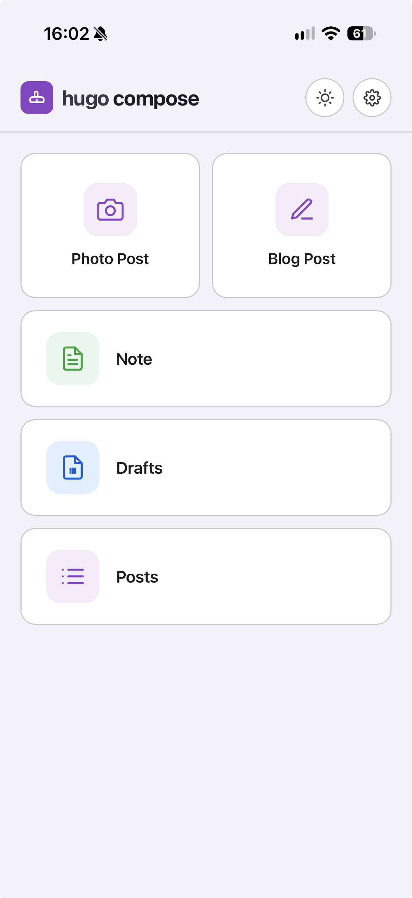

# Hugo Compose

A mobile-first progressive web app for creating photo posts and blog posts on any Hugo site, directly from your phone. No backend server, no CMS, no account — just a single HTML file that commits to GitHub.

<p align="center">
  
</p>

## What it does

Hugo Compose is a PWA that runs from your phone's home screen (or any browser) and publishes content to your Hugo site via the GitHub API. Write a post, attach photos, tap Publish — it creates a single Git commit with the page bundle and your CI/CD pipeline deploys it.

- **Photo posts** — pick photos, write a caption, add tags with `#hashtags`. Images are resized to JPEG (max 2000px) and committed as a Hugo page bundle with `feature.jpg` and numbered extras.
- **Blog posts** — Markdown editor with a formatting toolbar (bold, italic, headings, links, lists, quotes, code, horizontal rule). Attach images, designate a featured image, publish or save as draft.
- **Offline drafts** — write when you have no signal. Drafts are saved to IndexedDB with full image data and sync when you're back online.
- **Post list** — browse and edit your recent posts and photos from the app.
- **Notes** — optionally append date-stamped JSON entries to a data file in your repo (useful for logs, training notes, or any structured data Hugo can read).

Everything is configurable per site: content paths, front matter format (TOML or YAML), branch.

## How it works

1. You configure your GitHub username, repo, branch, and a Personal Access Token in Settings.
2. When you publish, the app uses the [Git Trees API](https://docs.github.com/en/rest/git/trees) to create a single atomic commit containing the `index.md` and all images.
3. Your existing CI/CD (GitHub Actions, Netlify, Cloudflare Pages, etc.) picks up the commit and deploys the site.

The token is stored in `localStorage` in your browser. It never leaves your device except to authenticate with the GitHub API.

## Setup

### 1. Add it to your Hugo site

Copy all files into your Hugo `static/` directory:

```
static/
  compose/
    index.html
    sw.js
    manifest.json
    icon.svg
    icon-180.png
    icon-192.png
    icon-512.png
```

After your next deploy, it will be available at `https://yoursite.com/compose/`.

Alternatively, serve it standalone:

```sh
python3 -m http.server 8080
# Open http://localhost:8080 in your browser
```

### 2. Create a GitHub token

Create a **fine-grained** Personal Access Token:

1. Go to github.com → Settings → Developer settings → Personal access tokens → Fine-grained tokens
2. Set repository access to your Hugo site repo **only**
3. Under Permissions → Repository permissions → Contents: **Read and write**
4. Generate and copy the token

### 3. Configure the app

Open the app and tap the gear icon to open Settings:

| Setting | Description | Example |
|---------|-------------|---------|
| **Personal Access Token** | Your GitHub fine-grained PAT | `github_pat_...` |
| **Owner** | Your GitHub username or org | `janedoe` |
| **Repository** | Your Hugo site repo | `my-blog` |
| **Branch** | The branch your CI deploys from | `main` |
| **Posts path** | Where blog posts live in the repo | `content/posts` |
| **Photos path** | Where photo posts live in the repo | `content/photos` |
| **Notes data file** | Optional JSON file for notes | `data/notes.json` |
| **Front matter format** | TOML (`+++`) or YAML (`---`) | `toml` |

Tap **Save**. The paths should match your Hugo content structure — just the path from the repo root, without a leading or trailing slash.

### 4. Install on your phone

On iOS Safari, open the app URL and tap **Share → Add to Home Screen**. It runs as a standalone app with its own icon, offline support, and no browser chrome.

On Android Chrome, tap the **Install** prompt or use the menu → **Add to Home Screen**.

## Content structure

Hugo Compose creates standard Hugo [page bundles](https://gohugo.io/content-management/page-bundles/):

### Photo posts

```
content/photos/2026/11/21-sunset-at-the-beach/
  index.md          ← front matter with title, date, description, tags, photos
  feature.jpg       ← first image (card thumbnail)
  image-2.jpg       ← additional images
  image-3.jpg
```

Tags are extracted from `#hashtags` in the caption. The slug is generated from the caption text.

### Blog posts

```
content/posts/2026/11/21/
  index.md          ← front matter + Markdown body
  feature.jpg       ← optional featured image
  image-2.jpg       ← optional additional images
```

### Front matter

TOML (default):
```toml
+++
title       = "Sunset at the beach"
date        = "2026-11-21T18:30:00Z"
description = "A lovely evening"
tags        = ["travel", "photography"]
photos      = ["image-2.jpg", "image-3.jpg"]
+++
```

YAML:
```yaml
---
title: "Sunset at the beach"
date: "2026-11-21T18:30:00Z"
description: "A lovely evening"
tags: ["travel", "photography"]
photos: ["image-2.jpg", "image-3.jpg"]
---
```

## Offline and drafts

Drafts are stored in IndexedDB (`dp_drafts_db`) and include images as Blob objects — no base64 overhead, no `localStorage` quota issues. They persist across app reloads and are scoped to the browser origin.

If you tap **Post** or **Publish** while offline, the content is automatically saved as a draft. A banner appears on the home screen when you have queued drafts; tap **Sync now** when you're back online to submit them.

You can also tap **Save draft** at any time to save your work without publishing.

## Image handling

- Images are resized client-side to a maximum of 2000px on the longest edge
- Output is JPEG regardless of input format
- The first image (or the one you designate) becomes `feature.jpg`
- Additional images are numbered `image-2.jpg`, `image-3.jpg`, etc.
- All processing happens in the browser — nothing is uploaded to any server except GitHub

## Notes (optional)

If you configure a **Notes data file** path in Settings (e.g. `data/notes.json`), a Note button appears on the home screen. Notes are date-stamped text entries appended to a JSON array in that file. Useful for training logs, daily notes, or any structured data your Hugo templates can read.

Leave the path empty to hide this feature.

## Architecture

The entire app is a single `index.html` file (~120 KB) with inline CSS and JavaScript. No build step, no dependencies, no framework.

| File | Purpose |
|------|---------|
| `index.html` | The complete app — UI, logic, GitHub API client |
| `sw.js` | Service worker for offline support and caching |
| `manifest.json` | Web app manifest for home screen installation |
| `icon.svg` | Vector icon |
| `icon-180.png` | iOS home screen icon (Apple Touch Icon) |
| `icon-192.png` | Android home screen icon |
| `icon-512.png` | Splash screen icon |
| `make-icons.html` | Utility to regenerate PNG icons from the SVG |

### iOS-specific handling

The app includes substantial work to handle iOS PWA quirks:

- `visualViewport` API to pin the UI to the visual viewport when the soft keyboard opens
- Soft keyboard detection via viewport height delta
- Grow-only textarea auto-resize (iOS fires spurious `input` events that break shrink-and-grow)
- iPad hardware keyboard detection (skips JS resize, uses natural CSS flex)
- Safe area insets for notched devices

## Customising icons

Open `make-icons.html` in a browser to generate new PNG icons from the SVG source. Download and replace:

- `icon-180.png` — Apple Touch Icon
- `icon-192.png` — Android / manifest icon
- `icon-512.png` — Splash screen

## Security

- Your GitHub token is stored in `localStorage` on your device only
- The token is sent only to `api.github.com` in `Authorization` headers
- No data is sent to any other server
- The service worker caches only the app's own assets
- Images are processed entirely client-side

## Browser support

Designed for mobile Safari (iOS 15+) and Chrome (Android). Works in any modern desktop browser. The PWA install experience is best on iOS Safari and Android Chrome.

## Compatibility

Works with any Hugo site that uses page bundles and deploys from a GitHub repository. Tested with:

- GitHub Actions
- GitHub Pages
- Netlify
- Cloudflare Pages
- AWS S3/CloudFront (with a GitHub Actions workflow)

The only requirement is a GitHub repo with a branch that triggers your build pipeline.

## Licence

MIT
